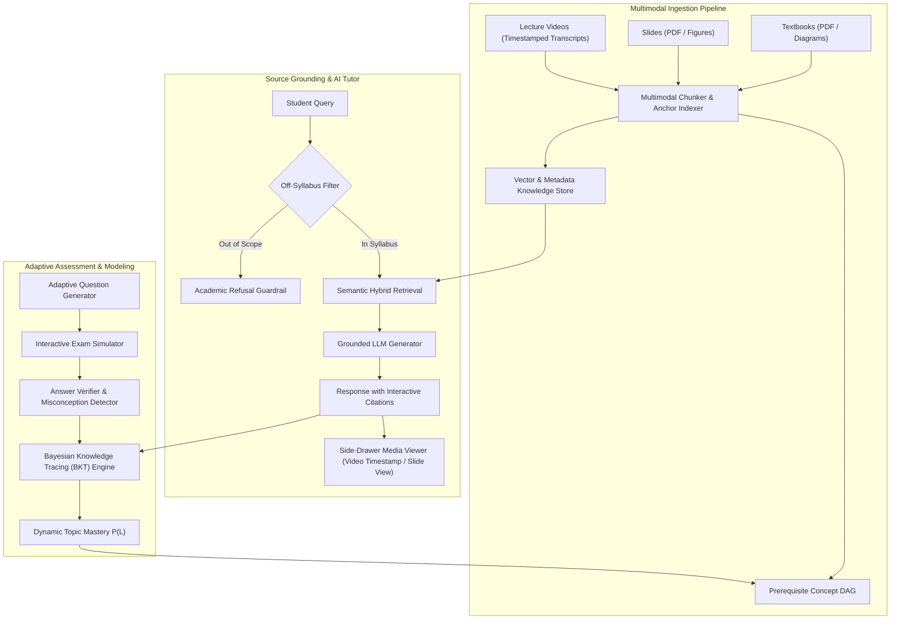

# ZENO System Architecture & Technical Documentation
**Track D: Personalized Tutoring & Adaptive Learning Challenge**

---

## 1. System Architecture Overview

ZENO is an AI study companion designed to ingest heterogeneous course materials (textbooks, lecture slides, and video lectures), extract multimodal concepts, and provide mathematically grounded, source-cited tutoring and adaptive assessments.

---

## 2. Multimodal Knowledge Base & Deep Anchor Tagging

Every content unit ingested into ZENO maintains an immutable metadata tuple:
$$\text{ContentUnit} = \langle \text{id}, \text{sourceType}, \text{sourceTitle}, \text{location}, \text{topicId}, \text{content}, \text{diagramUrl}, \text{prerequisites} \rangle$$

Where `location` is strictly anchored to:
- **Videos:** Exact start second $\tau$ and formatted label `mm:ss` (e.g. `14:35`).
- **Slides:** Slide sequence number (e.g. `Slide 8`).
- **Textbooks:** Edition and page number (e.g. `Page 84`).

---

## 3. Strict Grounding & Hallucination Prevention

To prevent hallucination, ZENO implements a two-stage guardrail:
1. **Scope Boundary Classifier:** Queries concerning topics outside the syllabus domain are declined with a transparent academic advisory.
2. **Citation-Locked Synthesis:** Explanations cite verified excerpts. Clicking citation badges immediately opens the source inspector to verify the excerpt against primary lecture materials.

---

## 4. Mathematical Bayesian Knowledge Tracing (BKT) Engine

ZENO tracks student topic mastery using Bayesian Knowledge Tracing across 4 probabilistic parameters:
- **$P(L_0) = 0.25$**: Initial prior belief of student skill mastery
- **$P(T) = 0.15$**: Transition probability (probability of student learning skill at this step)
- **$P(G) = 0.20$**: Guess probability (probability of correct answer despite non-mastery)
- **$P(S) = 0.10$**: Slip probability (probability of incorrect answer despite mastery)

### Posterior Update Equations:
Upon observing student answer response $X_t \in \{\text{Correct}, \text{Incorrect}\}$:

$$P(L_{t-1} \mid \text{Correct}) = \frac{P(L_{t-1}) \cdot (1 - P(S))}{P(L_{t-1}) \cdot (1 - P(S)) + (1 - P(L_{t-1})) \cdot P(G)}$$

$$P(L_{t-1} \mid \text{Incorrect}) = \frac{P(L_{t-1}) \cdot P(S)}{P(L_{t-1}) \cdot P(S) + (1 - P(L_{t-1})) \cdot (1 - P(G))}$$

### Learning Step:
$$P(L_t) = P(L_{t-1} \mid X_t) + (1 - P(L_{t-1} \mid X_t)) \cdot P(T)$$

---

## 5. Technology Stack
- **Frontend:** React 19, TypeScript 5.9, Tailwind CSS, Vite 7.2
- **Visualizations:** Custom SVG DAG layout, Lucide React icons, Canvas Confetti
- **Audio:** Web Speech API synthesis for bilingual audio tutor briefs
- **Data Architecture:** In-browser state with `localStorage` fallback and verified mock embeddings
